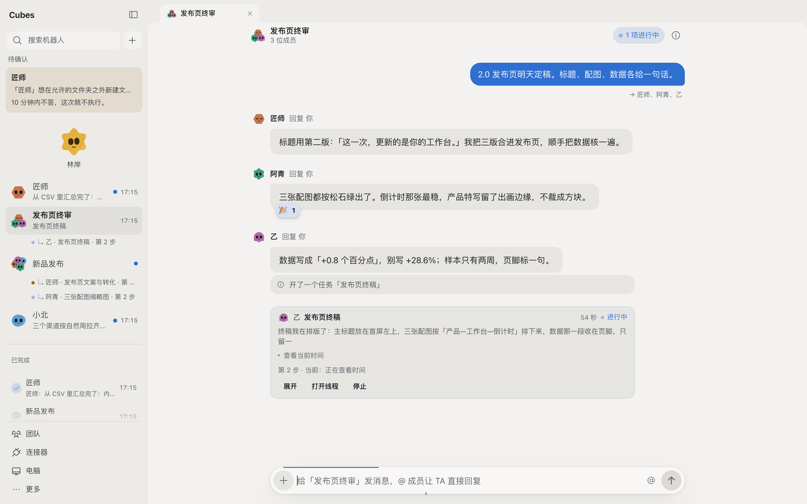
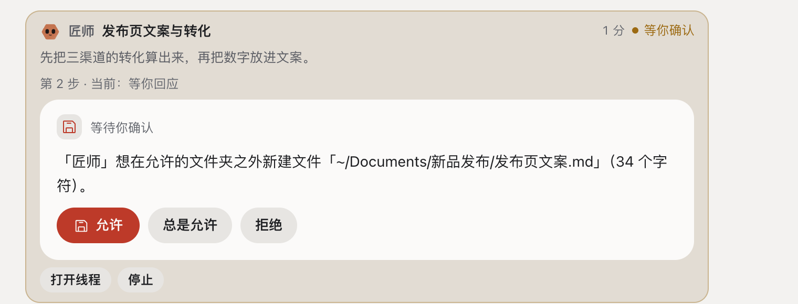
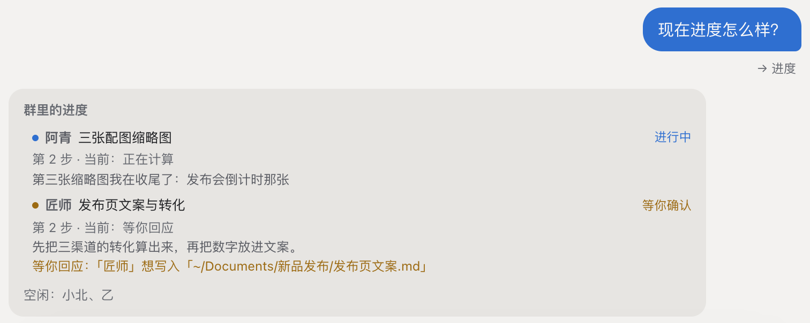
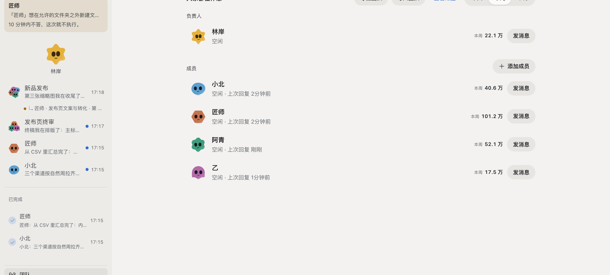
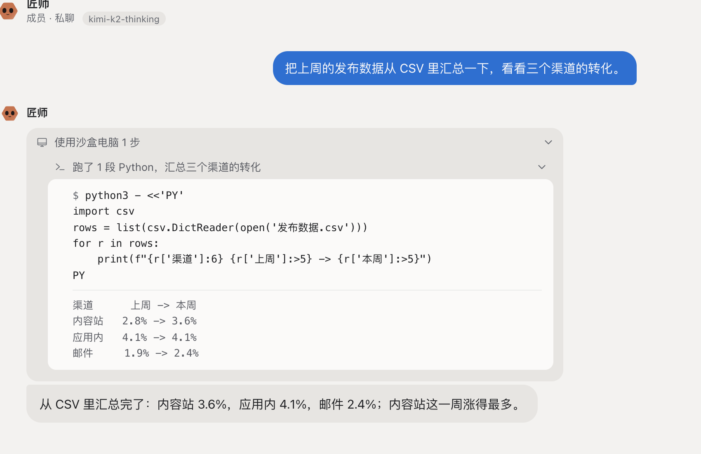
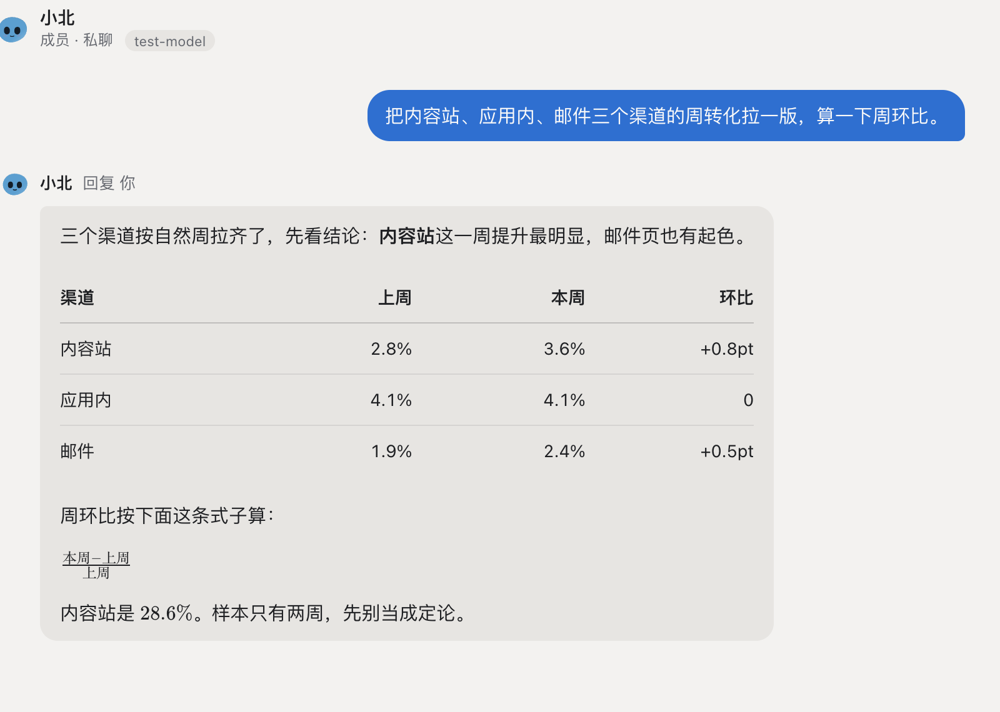
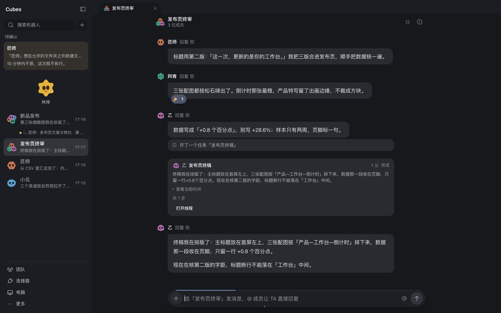

# Cubes · 主管团队



你和一支 AI 团队在同一张页面里工作：在群里说一句话，合适的人接活，要动手的事进自己的线程，做完把结果放回群里。你随时能看见过程，也能在它碰到你的文件之前叫停。

## 这是什么

Cubes 是一个本地优先的团队工作台。你有一位负责人（第一次打开时可以给它起名字、挑样子），也可以直接找任何成员说话；每位成员可以有自己的模型、工具权限和工作目录。

群组里没有「请谁依次回答」的按钮：一条群消息先交给一个看不见的分发员，它根据成员职责、最近发言、正在进行的任务和你的点名，决定谁来接。它只输出一个 JSON 决定，不发言，也不出现在聊天里。

需要几步、要花一会儿的活，成员会开一个任务线程。群里只留一张任务卡，卡上实时写着做到哪一步、刚说了什么；点开线程能看到完整过程。几件事可以同时做，工作流里的几条支路也可以真的并行。

机器人可以操作这台 Mac：跑终端命令、开一个 Cubes 自己的 Chrome 窗口按元素操作网页、截屏后按像素点击。第一次使用会先发一张确认卡；你也可以只让它用连上来的云端沙盒。

## 不是模板的那部分

### 每张脸都是画出来的

头像不是 emoji，也不是圆形裁图。头像是 Cubes 自己画的：21 种轮廓（圆、水滴、爱心、蛋、菱形、八边形、猫耳、熊耳、幽灵……），12 种身体色，眼睛颜色可以自动挑一个对比清楚的，也可以自己选。

眼睛、嘴和腮红长在同一个球面上。转头时靠近边缘的那只眼睛会压扁，转过去再转回来；嘴跟着心情变，说话时一张一合；开心的眼睛是圆头的「^ ^」。身体有厚度，会在纵深里转，左上方的光在轮廓上留下一道亮边。

它们会看你的鼠标（聊天区里 28px 以上的头像），有新消息时点头，开心时先蹲一下再跳起来，刚醒时左右环顾，空闲两分钟会闭眼睡着，往一侧歪着头慢慢呼吸。侧栏里的头像平时完全静止，只有鼠标进到它那一行、或这条会话正在干活时才活起来。系统打开「减少动态效果」时，它们保持静止。

第一次打开会先见到负责人：给它起名字，再挑形状、身体颜色和眼睛颜色，右边就是它会用的样子。点「开始使用」后，侧栏、消息署名、聊天标题和所有提到它的句子都改用这个名字和样子。

### 一条看不见的分支

群消息下面有一行很淡的字：

> → 匠师、阿青、乙

这就是分发员的决定。鼠标停上去会说明理由，点一下可以改派——正在回答的那次运行会先按正常路径停下，然后用你选的人重新回答，不新写一条用户消息。

被 `@名字` 点到的人一定回答；`@所有人` 会让每位成员同时、各自独立回答；「好的」「谢谢」这类话会被判成不需要回复。分发员不在成员名单里，没有工具，不写聊天内容。

### 活儿有自己的线程

一条群消息可以变成一张任务卡：

> 乙 · 发布页终稿 · 54 秒 · 进行中
>
> 终稿我在排版了：主标题放在首屏左上，三张配图按「产品—工作台—倒计时」排下来……
>
> 第 2 步 · 当前：正在查看时间

卡片上的字是流式来的，不是进度条。成员在线程里做的每一步、每一条工具结果都留在那里；群里只留卡片和最后一条结论。任务可以停下、接着做、交给别人，或者拆成几部分同时做。

### 你说了算的确认卡

要写文件、运行代码、用这台 Mac、连接器写操作，默认都先停在一张卡上：

> 等待你确认
>
> 「匠师」想在允许的文件夹之外新建文件「~/Documents/新品发布/发布页文案.md」（34 个字符）。
>
> [允许] [总是允许] [拒绝]

「总是允许」只放开卡上说的那一种操作和范围，规则可以在「设置 → 权限」里随时删掉。审批有三档：手动审批、自动审批、完全权限；每位成员还可以在自己的设置里换一档。定时任务在后台找不到人确认，所以要么先建一条「总是允许」规则，要么它自己换一种做法。

### 一天的样子

下面是截图里的真实文字，按发生顺序排：

```text
你    2.0 发布页明天定稿。标题、配图、数据各给一句话。
      → 匠师、阿青、乙

匠师  标题用第二版：「这一次，更新的是你的工作台。」我把三版合进发布页，顺手把数据核一遍。
阿青  三张配图都按松石绿出了。倒计时那张最稳，产品特写留了出画边缘，不裁成方块。  🎉 1
乙    数据写成「+0.8 个百分点」，别写 +28.6%；样本只有两周，页脚标一句。

      开了一个任务「发布页终稿」
      乙 · 发布页终稿 · 54 秒 · 进行中
      终稿我在排版了：主标题放在首屏左上……
      第 2 步 · 当前：正在查看时间
```

另一条线在等一张卡：

```text
等待你确认
「匠师」想在允许的文件夹之外新建文件「~/Documents/新品发布/发布页文案.md」（34 个字符）。
[允许] [总是允许] [拒绝]
```

### 设计上的几个坚持

- **确认卡是产品的一部分，不是失败提示。** 三档审批、逐条「总是允许」、10 分钟不答按拒绝处理；卡上写清是谁、要碰哪里、影响什么。定时任务在后台没人可问，就明确拒绝，不猜。
- **过程要看得见。** 任务卡直播当前一步；每次运行都能回看交接图，播放、暂停、单步、拖动回放。模型说得久时，旁边会写「正在思考（N 秒）」，不会假装还在出字。
- **本机优先。** 开发后端默认只绑 `127.0.0.1`；桌面版每次启动随机端口加一次性访问令牌，数据在本地 SQLite，网页用 Cubes 自己的 Chrome 配置。默认情况下，离开这台机器的只有你配置的模型服务、搜索请求和你主动接入的连接器。
- **主管默认只协调。** 在群里，主管的工具列表里没有终端、浏览器、写文件和改工作台；它整理进度、检查结果、催办停住的任务。用 `@主管` 点名的那一轮才恢复完整工具。
- **动画要能关掉。** 头像、表情粒子、工作流画布、展开收起都遵守系统的「减少动态效果」；打开时直接到位，粒子和光点不出现。
- **不假装。** 没有预设角色，也没有本地假回复；模型连不上、被限流、没有额度，就在这次回复里说清原因。看不到图片的模型只会收到文件名，不会收到一张它读不懂的图。

## 看看界面



*任务卡里也能直接出现确认卡：要写哪个文件、多少字、在哪，原样写在卡上。*



*问一句「进度怎么样」，分发员不叫任何人，直接用任务数据发一张进度卡。*



*团队页：每个人的形状、颜色和眼睛都不一样；右边是这一周用掉的 token，点预算就能改。*



*终端一步展开：完整的 `python3` heredoc 和它的输出，不截断。*



*回复按 Markdown 渲染，表格和 KaTeX 公式都在；这里算的是周环比 $\frac{本周-上周}{上周}$。*



*深色主题。完成、进行中和等待确认会同时出现在一屏里，状态用颜色和一行小字区分。*

## 快速开始

需要 Python 3.11+。桌面版还需要 Node 22+；只有打包（`npm run build:desktop`）才需要 `uv`。

### 桌面版（开发）

```bash
cd backend
python3 -m venv .venv
.venv/bin/python -m pip install -r requirements.txt
cp -n .env.example .env      # 可以先留空，启动后到「设置 → 模型」添加

cd ../web
npm install
npm --prefix electron install
npm run desktop
```

`npm run desktop` 会自己起开发服务器和后端（用 `backend/.venv` 和 `backend/.env`），不需要另开 `uvicorn`。第一次打开先给负责人起名字、挑样子；团队里只有它，也还没有模型服务。

`.env` 里的 `MODEL_API_KEY` 和 `MODEL_NAME` 只在首次启动、数据库里还没有模型服务时导入成一个叫 `mify` 的服务。之后都在「设置 → 模型」里管理；改 `.env` 不再生效。

### 浏览器版

先在一个终端里启动后端：

```bash
cd backend
.venv/bin/python -m uvicorn app.main:app \
  --host 127.0.0.1 --port 8000 \
  --timeout-graceful-shutdown 5
```

再在另一个终端里：

```bash
cd web
npm install
npm run dev
```

打开 `http://127.0.0.1:1420`。浏览器版没有自带后端，连的是「设置」里的地址（默认 `http://127.0.0.1:8000`）。

部署到服务器、运行 iOS、打包桌面 App 的完整步骤在 [docs/setup.md](docs/setup.md)。

## 功能一览

| 方向 | 你能做什么 | 细节 |
| --- | --- | --- |
| 对话与群组 | 一个机器人一条私聊；群组里 `@` 点名、`@所有人`、引用、编辑与「从这里重新开始」 | [docs/features.md](docs/features.md) |
| 任务与并行 | 大活进任务线程；`run_subtasks` 最多拆 5 个并行小任务；工作流最多同时跑 4 条支路 | [docs/features.md](docs/features.md) |
| 电脑与浏览器 | 操作这台 Mac 或云端沙盒；终端、浏览器元素、屏幕像素三种入口；网页用 Cubes 自己的 Chrome | [docs/computer.md](docs/computer.md) |
| 记忆与技能 | 本地全文索引的长期记忆；从 Claude Code、Codex 等目录导入技能，先停用、看过再启用 | [docs/features.md](docs/features.md) |
| 模型与引擎 | 多套 OpenAI 兼容 / Anthropic 服务；每个 bot 单独选模型；Claude Code / Codex 订阅当引擎；备用模型 | [docs/models.md](docs/models.md) |
| 工作流与定时 | 画布上连节点、画循环线；暂停、跳过、重跑；一次 / 间隔 / cron；提醒；Webhook | [docs/features.md](docs/features.md) |
| 桌面与 iOS | Electron 打包、内置后端、透明窗口材质；SwiftUI iOS 客户端 | [docs/setup.md](docs/setup.md) |
| 命令行与 MCP | `cubes status / bots / send / result`；`cubes mcp` 只给四个安全工具 | [docs/cli.md](docs/cli.md) |

## 文档

- [功能细节](docs/features.md)：原来「已实现」的全部条目，按主题分组，一条没删。
- [安装与部署](docs/setup.md)：后端、服务器、iOS、Web 和桌面端、内嵌后端。
- [模型服务与引擎](docs/models.md)：多套服务、按 bot 选模型、备用模型、Claude Code / Codex。
- [电脑](docs/computer.md)：本机、云端沙盒、终端、浏览器、屏幕和各自的步数上限。
- [从命令行使用](docs/cli.md)：`cubes` 命令、退出码、Claude Desktop / Cursor 的 MCP 配置。
- [接口速查](docs/api.md)：主要 HTTP 接口和 SSE 事件。
- [安全边界](docs/security.md)：完整的安全说明。

## 仓库结构

| 目录 | 是什么 |
| --- | --- |
| `backend/` | FastAPI + SQLite：团队、会话、引擎、工具、工作流、定时任务 |
| `web/` | React + Vite 页面，`web/electron/` 是桌面壳 |
| `cubes/` | SwiftUI iOS 客户端 |
| `computer/` | 云端沙盒的容器配置和里面运行的连接程序 |
| `docs/` | 上面这些说明和本文的截图 |

## 安全边界

开发模式的后端没有账户系统或访问鉴权，只用于本机或受信任网络，不要直接暴露到公网。桌面版由 App 自己启动后端，带一个随机端口和一次性访问令牌，本机别的进程打不开它；但同一用户能读 `data/` 目录时，仍能看到数据库里的明文 key。

对话以明文存入本地 SQLite；指定模型地址使用 HTTP 时，请求正文和凭据没有传输加密。

工具包让模型能上网、记事、算数、读写文件：

- 搜索会把查询词发给选中的第三方搜索服务，请求离开本机。
- 运行代码不是沙箱：子进程以当前用户身份运行，只是拿不到模型和搜索密钥，最长 60 秒、输出有上限。有敏感数据的账号上请留在手动审批。
- 「本机」直接操作后端所在的电脑。桌面版就是这台 Mac，第一次使用会先问你允许；截图、命令输出和网页内容会存进本地数据库，并发给当前模型服务。

完整说明见 [docs/security.md](docs/security.md)。
